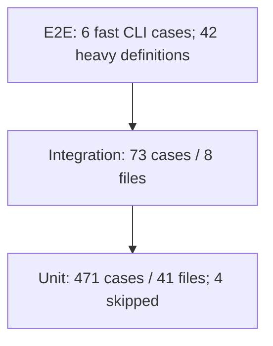
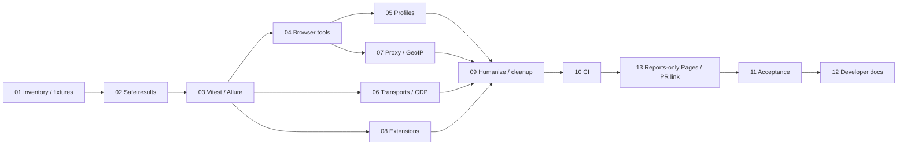
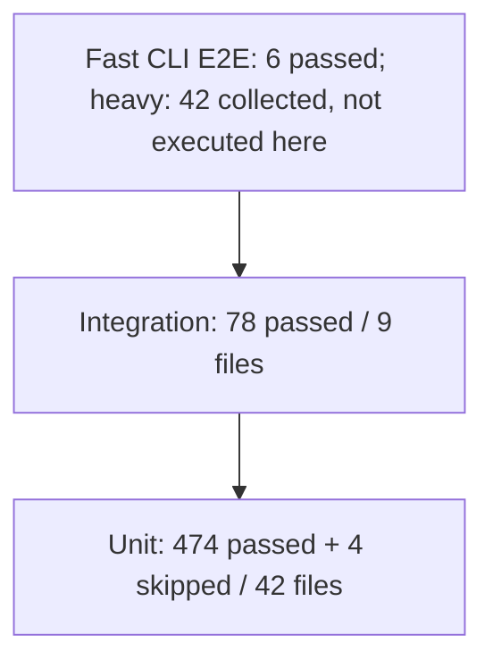

# Automated testing and reporting delivery plan

Status: Planned; specification approved; explicit packet authorization required
Depth: Standard
Profiles: core, operations, security

## Remote CI observation policy

The agent must not wait for remote CI completion, poll it repeatedly, or schedule
background monitoring. Inspect remote run/job status only when the user requests
it. If required jobs are pending or running, report that state and leave their
acceptance evidence unresolved. When all relevant jobs have finished, inspect
conclusions, logs and artifacts before drawing conclusions or making authorized
corrections. A cancelled, skipped or failed required check is not a pass.
CI workflows may still aggregate results automatically through job dependencies;
this policy governs agent observation, not workflow execution. Local checks remain
part of their authorized implementation packets.

## Selected report delivery components

Use [Allure Report 3](https://github.com/allure-framework/allure3) to generate one
combined matrix report, [peaceiris/actions-gh-pages](https://github.com/peaceiris/actions-gh-pages)
to publish it to a separate repository, and the official
[allure-framework/allure-action](https://github.com/allure-framework/allure-action)
to show statistics and its deployed link in the PR through `remote-href`.
The Allure Action does not host reports. Select and audit supported Action
releases, then pin full commit SHAs during implementation.

The source remains `swimmwatch/cloakbrowser-mcp`; the proposed reports-only
destination is `swimmwatch/cloakbrowser-mcp-reports` (exact identity and creation
require separate authorization). Configure that repository's Pages from the root
of `gh-pages`. Set publisher `external_repository`, `publish_branch: gh-pages`
and `keep_files: true`; guarded cleanup separately enforces 14-day retention.
Use a short-lived, reports-repository-scoped GitHub App token. Preserve the
existing documentation deployment and site.

One PR/run/attempt/SHA URL opens the combined report with OS/Node variants.
Publish the verified URL in one updated bot-owned PR comment and Job Summary.
Concrete configuration, trust checks and expected URLs are in
[packet 13](13_public-report-delivery.md#selected-projects-actions-and-repositories).
This choice is covered by the approved, independently reviewed specification.

## Authority and execution boundary

Approved behavior is owned by [spec.md](../spec.md). This plan orders delivery;
it does not change scope or authorize implementation.

- Repository: `/home/dmitry-vasiliev/.codex/worktrees/release-v1-15-0/cloakbrowser-mcp`
- Branch: `release/v1.15.0`; inspected HEAD: `00fcaf51f188bdb6528da2284284f4b04c5ebcb2`
- `source_version`: `785424ba80d8dbf709c51901135a288276377b0a5aa08958d25c7d6ba2988a83`
- `specification_version`: `9eb3ca847f6421bd03834981a659066362922abcffcd79605c63d04cd9e30a7e`
- `review_ref`: `28b4daa7-1f0e-4286-ace1-eace5f685e70`
- Scope and freshness checked through scenario MCP on 2026-10-10; pass/reviewed.
- No separate profile artifacts are authorized: `planning_artifacts: []`.
  Applicable contracts are inline here and in task packets.

### User-directed report delivery amendment (2026-10-10)

The user accepted planning public Allure delivery through a separate repository
with its own GitHub Pages and a PR link. This replaces the earlier no-Pages/no-comment
delivery choice without authorizing external setup or publication. MCP decision:
`301e19f0-2621-412e-b6b4-dc23d3666ddd`, revision 1.
`cloakbrowser-mcp-reports` is an example name, not an existing or reserved repository.

The specification owner reconciled TEST-007/008/009 and the scope manifest after
the user's explicit approval. Independent review passed all 22 items, including
whole-specification consistency; MCP reports pass/reviewed with an Approved
document and recorded approval checkpoint. The pins above and all packet inputs
now identify that reviewed amendment. Implementation and external setup remain
separately authorized actions.

Before executing one explicitly authorized packet, inspect Git status including
staged and untracked changes, recheck these pins through MCP and reread affected
source evidence. Stop on drift that changes approved behavior. A clean tree,
commit or optional review is not a prerequisite. Complete that packet's required
checks, update [todo.md](todo.md) and replace [handoff.md](handoff.md), then stop.
Do not automatically execute the next packet.

Preserve the unrelated `reports/pr-142-e2e-2026-09-22.md`. Do not transfer changes
from `feature/cdp-protocol`. No release version bump, Docker base upgrade,
upstream tool adapter, license use, commit, push, PR or publication is authorized.

## Baseline and pyramid

The specification records the 2026-10-09 coverage run, not a new planning run:
544 collected cases, 540 passed, 4 skipped. Unit: 471 cases / 41 files;
Integration: 73 cases / 8 files. Fast packaged CLI E2E: 6 cases with fake upstream
or CLI processes. Heavy suites: 42 collected definitions, including parameterized
and gated cases; these are not 42 executed browser cases.

Coverage baseline: lines 87.81%, functions 88.92%, branches 80.37%; statements
were not separately recorded. Preserve thresholds 85% lines/statements/functions,
75% branches and Codecov. Packets 01 and 11 record runner-derived counts and
scenario evidence; no prospective test count or coverage gain is promised.

## Ownership and dependency direction

Test tooling is development-only. Production flow remains client → bridge →
upstream MCP → Chromium. Existing ownership: `src/server.ts:98` creates the proxy;
`:125` and `:143` forward tool contracts; `src/bridge/config.ts:224` owns
configuration and rollback; `src/http/server.ts:93` owns HTTP sessions;
`src/cdp/session.ts:33` owns managed CDP startup and teardown.

Proposed tooling units and symbols, mapped to TEST-001/006–010:

| Owner                                                                       | Purpose; inputs → outputs                                                                                                             | Lifecycle, errors and direction                                                                                                                                                  |
| --------------------------------------------------------------------------- | ------------------------------------------------------------------------------------------------------------------------------------- | -------------------------------------------------------------------------------------------------------------------------------------------------------------------------------- |
| `tests/e2e/distributionHarness.ts`, `tests/helpers/browser-test-runtime.ts` | `createFreeBrowserRuntime`, `dispose`: selected Free executable and temp root → owned environment, children and fixtures              | Runtime owns child PIDs, sockets, caches and profiles; cleanup on every path. No inherited license, unknown binary, global process kill or runtime API change                    |
| `scripts/lib/test-results.mjs`                                              | `writeTestResult`, `mergeTestResults`: validated, sanitized evidence → standard Allure result JSON, attachments and producer manifest | Writes atomically into one run/producer namespace; rejects invalid identity, escaping paths, symlinks, conflicting UUIDs and missing producer evidence                           |
| `scripts/lib/test-diagnostics.mjs`                                          | `sanitizeDiagnostic`: structured bounded diagnostics → redacted text; controlled local PNG → approved attachment bytes                | No arbitrary file reader or environment dump. Reject unsupported binary/provenance; report rejection without retaining input                                                     |
| `scripts/testing/allure-reporter.ts`                                        | `SafeAllureReporter`: public Vitest TestCase/TestModule callbacks → result writer calls                                               | Tracks one runner invocation; exports results for completed/skipped tests and synthetic runner errors. Awaits flush; failure to write or zero unexpected results fails reporting |
| `scripts/test-report.mjs` and `allure.config.mjs`                           | collect, generate, open and merge commands → isolated results, HTML and optional prior-run history                                    | Native Node spawning with argument arrays; preserve test exit status; generate only from validated evidence; no Java, server deployment or runtime CLI flags                     |
| `.github/workflows/ci.yml` and one manual/scheduled test workflow           | producer jobs → sanitized artifacts → validated aggregate HTML and summary                                                            | Artifact namespaces include producer identity; read-only permissions, bounded retention, missing-job evidence; trusted history cannot be updated by PR/fork jobs                 |
| Trusted publisher and separate reports repository                           | completed CI → validated results → rebuilt HTML → reports-only Pages → PR link                                                        | Packet 13 owns public delivery; publisher code comes from the trusted default branch. Documentation deployment is outside this ownership                                         |

Reporter → diagnostics/result writer. Report CLI → result validator/merger →
Allure 3 CLI. Tests → existing distribution harness/controlled fixtures →
installed npm CLI. Runtime source never imports reporting code.

### Core contract

Keep Vitest 5.0.1 and use its public Reporter API. The official
`allure-vitest@3.13.0` probe produced zero results against this runner; do not
downgrade Vitest or patch private `test.task` fields. Use development dependency
`allure@3.20.1`, subject to packet 03's actual HTML/history probe. Consume standard
Allure result JSON. Existing public callback evidence:
`node_modules/vitest/dist/chunks/plugin.d.CN87HSxv.d.ts:100`, `:138`, `:155`,
`:253`, `:2126`; re-resolve the installed type file rather than relying on its
generated name after dependency drift.

Result identity combines repository-relative test file, full test name and project.
Environment variant combines OS, architecture, Node major, browser engine and lane;
producer/shard IDs distinguish files without splitting test history. Use UUIDs for
stored files. Preserve retry count/flaky evidence reported by Vitest; do not invent
timing or individual retry attempts unavailable from the public API. Prior launch
history is separate from retries in one launch. Group by feature, level and environment.
Default feature derives from a checked file-to-feature map; optional public annotations
refine grouping. Unknown feature mappings are explicit inventory gaps.

New development commands planned in packet 03:
`test:report`, `test:report:generate`, `test:report:open`,
`test:report:merge`, `test:report:probe`.
They do not exist yet. Test runs start separate `artifacts/test-results/<run>/<producer>`
namespaces. An explicit rerun may reuse the intended history lineage. Ordinary
`check` keeps its current tests and exit behavior. Reporting is enabled in test lanes,
not injected into production stdout.

### Operations contract

Keep fast required PR jobs and the existing required-job aggregate. Add heavy
functional scenarios to manual/scheduled lanes; retain existing mandatory console,
CDP and Docker checks. Aggregate uses `always()` without masking producer failures.
A producer manifest records environment, runner exit, counts, omissions and completed
flush; missing or truncated manifests are not successful empty results.

Retention: 14 days for results/HTML artifacts; trust-separated history uses the
same bounded retention. Summary reports passed/failed/broken/skipped, duration,
retry evidence and missing producers. Artifact access follows GitHub repository
permissions; artifacts are not a secret store. Packet 13 adds public HTML on a
separate reports-only Pages site and one updated PR comment; no external reporting
service is introduced. Trusted history restore/save is limited to default-branch trusted
runs in the same lane and environment; PR/fork runs may not update it.

Report repository credentials can write only to the separate reports repository.
PR-comment permission belongs only to the trusted publisher job; producers stay
read-only. Public preview publication never updates trusted default-branch history.
One CI run yields one merged report retaining every environment variant. Immutable
paths identify PR, run ID, attempt and tested SHA. The bot comment and Job Summary
link to the deployed report, show SHA/status counts and mark incomplete output.
Recheck current PR head/latest run before updating the comment; reject stale updates.

Retain public reports for 14 days. Cleanup deletes only expired report paths,
preserving other PRs/runs. Existing documentation deployment at
`.github/workflows/release.yml:377`, `:392` and `:407`, its `site/` output and Pages
settings must not be changed. Separate project repositories can share a Pages
origin: regenerate HTML with trusted pinned assets instead of publishing arbitrary
HTML/JavaScript from PR artifacts.

Resource acceptance: after each bounded cycle, owned children exit, profiles unlock,
listeners/fixture sockets close and temp data is removed. Use observable child
exit/close events and failed reconnect to closed owned ports, not only arrays of
cleanup callbacks. Timeouts bound cleanup and fail the test; they never justify
killing unrelated processes. Memory evidence uses the existing deterministic
detached-DOM collection check and repeated lifecycle cleanup. Long-duration RSS
trends are supplemental P2 evidence, not proof of memory safety.

### Security contract

Assets: process credentials, tokens, capability URLs, private profile data, diagnostics
and trusted history. Boundaries: test process → persisted results → CI artifact →
aggregate validator → generated HTML. Producer metadata and artifacts are untrusted
input at aggregation; do not execute their code, fetch links or extract unrestricted
archives.

Redact authorization/cookie headers, password/token/key fields, proxy userinfo,
known secret values and CDP capability URLs before initial persistence and again
before aggregation/generation/upload. Do not serialize arbitrary environment maps.
Use disposable synthetic canaries in tests. Logs are bounded to 128 KiB per attachment;
PNG to 2 MiB; all attachments to 6 MiB per test. Validate every attachment reference
against its producer root, reject symlinks/traversal/unsupported formats and fail
closed for unsafe report generation. Capture PNG only through the controlled-local
fixture helper; remote pages, credential inputs and arbitrary image files cannot
be attached. Validate allowlisted metadata and JSON fields; do not pass arbitrary
HTML annotations into the report.

Limits are tooling policy, not new product options. No runtime flags, environment
aliases or public MCP tools are introduced.

## Packets and dependencies

| ID                                  | Priority | Outcome                                                                 | Dependencies                |
| ----------------------------------- | -------- | ----------------------------------------------------------------------- | --------------------------- |
| [01](01_inventory-and-fixtures.md)  | P0       | Complete scenario inventory and Free/resource fixture ownership         | Approved spec               |
| [02](02_safe-results.md)            | P0       | Safe result persistence, attachments and merge                          | 01                          |
| [03](03_vitest-and-allure.md)       | P0       | Public Vitest adapter, local HTML/history and pass/fail probes          | 02                          |
| [04](04_browser-tools.md)           | P0       | Real outcomes for every tool, navigation, upload/download               | 01, 03                      |
| [05](05_profiles-and-state.md)      | P0       | Persistent and temporary state isolation, locks and restart             | 04                          |
| [06](06_transports-and-cdp.md)      | P0       | Missing transport/CDP error and recovery assertions                     | 01, 03                      |
| [07](07_proxy-and-geoip.md)         | P1       | Actual proxy routing and deterministic GeoIP lookup                     | 04                          |
| [08](08_extensions.md)              | P1       | Both extension mechanisms with actual attachment                        | 01, 03                      |
| [09](09_humanize-and-resources.md)  | P0/P1    | Humanize gaps and repeated success/failure cleanup                      | 04, 05, 06, 07, 08          |
| [10](10_ci-reporting.md)            | P1       | CI aggregation, trusted history and periodic/platform lanes             | 03–09                       |
| [13](13_public-report-delivery.md)  | P1       | Reports-only Pages and current-commit PR link                           | 10; approved external setup |
| [11](11_functional-acceptance.md)   | P1       | Full scenario/platform evidence, delivery acceptance and final coverage | 10, 13                      |
| [12](12_developer-documentation.md) | P1       | Verified instructions and 10 localized updates                          | 11                          |

Run browser scenarios sequentially within an owning lane. Packets editing
`npm-package.manual.ts` are ordered 04 → 05 → 09. Do not run fixture/browser
preparation concurrently against shared profiles or caches. Independent packet
dependencies permit ordering choices; they do not authorize delegation or execution.

## Requirement coverage

| Requirement | Owning packets         | Discriminating evidence                                                                |
| ----------- | ---------------------- | -------------------------------------------------------------------------------------- |
| TEST-001    | 01, 11, 12             | Runner counts, complete scenario matrix, duplicate/flake assessment                    |
| TEST-002    | 03, 10, 11             | Unchanged required aggregate; separate heavy lane; visible failed producers            |
| TEST-003    | 05                     | Real cookie/localStorage restart and independent-profile absence                       |
| TEST-004    | 04                     | Exact saved download bytes and upload receiver bytes                                   |
| TEST-005    | 07                     | Local proxy request ledger, rendered content, failure and clean recovery               |
| TEST-006    | 02, 03, 10             | Pass/fail/skip/retry/import/hook/unhandled probes and runner counts                    |
| TEST-007    | 01, 02, 03, 09, 10, 13 | Controlled diagnostics; canaries absent from JSON/HTML/artifacts/public output         |
| TEST-008    | 03, 11, 12, 13         | Local HTML/history and package exclusion; public delivery covered by reviewed TEST-009 |
| TEST-009    | 02, 03, 10, 11, 13     | Merge/summary/history isolation; reviewed Pages/PR-link delivery                       |
| TEST-010    | 01, 06, 08–12          | Portable tooling, Free selection, actual native/Docker environment evidence            |
| TEST-011    | 01, 04–12              | All twelve key areas below, with observed positive/negative outcomes                   |

### All key functional areas

Packet 01 expands this map into explicit existing/new scenario-to-test rows inside
`plan.md`; packet 11 fills actual outcome, environment and run evidence. Do not
duplicate authoritative behavior from the specification or label a configured job
as executed evidence.

| Area                   | Existing source evidence                                                                               | Mandatory scenario/assertion additions or reuse                                                                                                                                   | Owner          |
| ---------------------- | ------------------------------------------------------------------------------------------------------ | --------------------------------------------------------------------------------------------------------------------------------------------------------------------------------- | -------------- |
| CLI/config             | `tests/unit/config.test.ts:784`; `tests/unit/doctor.test.ts:31`; `tests/e2e/distributionHarness.ts:66` | Help/version/doctor, precedence, invalid options, both engines, startup errors; map existing cases and add only uncovered boundaries                                              | 01, 06         |
| MCP tools/contracts    | `src/server.ts:125`; `tests/e2e/npm-package.manual.ts:22`                                              | Actual upstream schemas unchanged; every returned standard tool + both local tools; explicit applicable invalid-input errors                                                      | 04             |
| Browser automation     | `tests/e2e/npm-package.manual.ts:90`, `:131`; `tests/e2e/npm-browser-fixture.ts:7`                     | Navigate/back/tabs, snapshot/find file, clicks/hover/drag/drop, keys/forms/dialogs/iframe, screenshot/log/network, upload receiver/download bytes, page-close/navigation recovery | 04, 09         |
| Profiles/state         | `src/bridge/profile-seed.ts:10`; `src/bridge/config.ts:878`; `tests/e2e/npm-package.manual.ts:194`     | Seed/overrides/lock rollback reuse; cookie/localStorage restart; persistent-profile and temporary-session isolation; unlock after error                                           | 05             |
| MCP transports         | `tests/integration/streamable-http.test.ts:617`, `:752`, `:1296`, `:1391`                              | Packaged stdio purity; HTTP initialize/isolation/unknown/expired session; upstream error/disconnect, cancellation and shutdown using existing public contracts                    | 06             |
| CDP                    | `tests/e2e/cdp-access.manual.ts:110`, `:284`, `:655`, `:680`; `src/cdp/session.ts:33`                  | Real HTTP/WS/shared state, concurrent isolation, auth/capability/origin/TLS, generation rotation, failure/cleanup; retain sufficient checks                                       | 06, 09         |
| Proxy                  | `src/bridge/config.ts:1144`; `docs/geoip-proxy-matching.md:206`                                        | Supported HTTP/auth/SOCKS routing, credential redaction, bypass, failed proxy then clean navigation; request API limitation unchanged                                             | 07             |
| Extensions             | `src/bridge/config.ts:364`; `tests/unit/config.test.ts:1145`; `docs/configuration.md:281`              | Unpacked content-script effect; official extension actual attachment/action; token/pairing rejection, disconnect/recovery; preserve incompatible-mode checks                      | 08             |
| Humanize               | `tests/e2e/npm-package.manual.ts:239`; `tests/unit/humanize-compatibility.test.ts:46`, `:93`           | Both presets, old/new tabs, iframe visibility, complex/ambiguous locators, special inputs, modifiers, MCP errors and detached-DOM collection; reuse existing real checks          | 09             |
| GeoIP                  | `tests/unit/config.test.ts:1016`; `node_modules/cloakbrowser/dist/geoip.js:70`                         | Real controlled exit-IP + MMDB lookup; browser timezone/locale/language, disabled/override cases, fail-closed database/lookup/timeout errors                                      | 07             |
| Concurrency/lifecycle  | `tests/e2e/npm-package.manual.ts:401`; `src/bridge/config.ts:250`; `src/http/sessionStore.ts:25`       | Concurrent cold-cache download/stdout, bounded repeated successful/failed start/close; owned PIDs/ports/sockets/profile locks cleaned                                             | 01, 05, 06, 09 |
| Distribution/platforms | `vitest.distribution-e2e.config.mjs:15`; `.github/workflows/ci.yml:18`, `:33`, `:187`                  | Installed npm, container build/entrypoint/smoke/parity, native platforms/architectures/Node, exact npm vs Docker dependency evidence                                              | 10, 11         |

## Controlled fixtures and feasibility

Reuse local server and template ownership from `tests/e2e/npm-browser-fixture.ts:7`,
`:23`, `:29`. Full pages belong in templates; CSS/JS use their respective tags,
not inline style/event attributes. Fixtures bind loopback ephemeral ports and own
all active connections. Upload/download bytes and state use temporary directories.

Free selection must use a known Free binary, empty license environment and a new
cache without `license.key`. An empty key alone falls through to the saved cache
key: `node_modules/cloakbrowser/dist/license.js:284`, `:292`.
Set `PLAYWRIGHT_BROWSERS_PATH` to an owned temporary directory for upstream
browser installation as well; no personal browser cache is test-owned.
Do not copy a Pro binary or reuse personal home/cache. Cold-cache tests obtain the
official Free distribution through its existing downloader; download failure is a
visible failed prerequisite.

GeoIP: pin the official MaxMind test database from
[MaxMind-DB](https://github.com/maxmind/MaxMind-DB/blob/6a690a705bc6962c0025a32e94a8f0dc8f86418c/test-data/GeoIP2-City-Test.mmdb),
commit `6a690a705bc6962c0025a32e94a8f0dc8f86418c`, Git blob
`e20846ac1757a3745ae41411757ed3817536e3be`, 22,569 bytes, MIT license notice.
The corresponding source-data record `::81.2.69.160/123` identifies GB /
Europe/London. Fixture readiness must prove actual `Reader.get("81.2.69.160")`
and the expected `en-GB` mapping before browser assertions. Copy the database into
the temporary cache with fresh mtime. A restricted local CONNECT proxy serves the
three upstream echo authorities with fixture CA/SAN certificates and that fixed IP.
Trust the CA only in the test child via `NODE_EXTRA_CA_CERTS`; never disable TLS
verification globally. The healthy path uses actual lookup, not injected options.
A test-only preload may reject the known GeoIP database download URL for the
missing-database negative case; disclose that network fault injection, keep actual
proxy-IP discovery, and never patch a runtime private fetch API.

Official extension: use
[Playwright source](https://github.com/microsoft/playwright/tree/e8149b8257d32dcf8f72573ecc43e72439da7080/packages/extension),
commit `e8149b8257d32dcf8f72573ecc43e72439da7080`, the published
`playwright-core@1.64.0-alpha-1790635538000` gitHead. Source manifest version is
0.4.0. Prepare its locked Vite build in a disposable source checkout, preserving
Apache-2.0 notices; do not add its build dependencies to this project.
Follow the actual
[upstream fixture](https://github.com/microsoft/playwright/blob/e8149b8257d32dcf8f72573ecc43e72439da7080/tests/extension/extension-fixtures.ts#L49):
headed Free Chromium, persistent profile, loaded official extension and browser
singleton behavior (`ignoreDefaultArgs: ["--enable-automation"]`).
Pass the bridge's existing userDataDir/profile configuration and token; derive
the extension ID from the pinned manifest rather than maintaining another constant.
No fake relay, Web Store auto-update, private runtime adapter or personal browser.

These are concrete preparation approaches, not executed capability evidence.
Packet 08 runs an early attachment probe. Failure against supported Free Chromium
blocks that packet; do not silently replace it with mocks or move it to P2.

## Platform and lane acceptance

| Environment                                           | Planned evidence                                                                                                                          | Execution owner                                      |
| ----------------------------------------------------- | ----------------------------------------------------------------------------------------------------------------------------------------- | ---------------------------------------------------- |
| Linux amd64 / arm64; macOS arm64 / Intel; Windows x64 | Existing native quality/CLI jobs; reporting probe and selected real Free scenarios on each native runner; paths, signals, TLS and cleanup | Packet 10 configures; packet 11 collects actual runs |
| Node 22/24/25/26 currently selected in CI             | Existing matrix plus public reporter success/failure probe on each installed supported major; retain runtime floor `^22.13.0              |                                                      | >=24` | Packets 03, 10, 11 |
| Real npm browser, both engines                        | Installed package with Free Cloak and controlled Playwright executable; serial functional tests and isolated caches                       | Packets 04–09, 11                                    |
| Docker Linux amd64 / arm64                            | Existing build/distribution/CDP jobs, version readback, entrypoint/smoke/parity and sanitized reports                                     | Packets 10, 11                                       |
| Headed extension on supported native runners          | Real loaded extension, token pairing/action and supported restart                                                                         | Packets 08, 10, 11                                   |

Do not add a full browser × Node × platform Cartesian product to PR requirements.
Use the existing native matrix for quick checks and reporting; periodic/manual
lanes cover real browser behavior on each supported native platform and Docker
architecture. Record justified, explicit unsupported combinations from existing
contracts; lack of an available runner is an unverified blocker, not unsupported
product behavior.

Docker remains MCP 0.0.82 while npm uses 0.0.83 (`package-lock.json:991` and
`Dockerfile:4` pinned base). Testing the current container establishes its actual
version only. The official-image monitor and stable v1.15.0 release blockers are
separate work; this plan neither updates the base nor claims release readiness.

## Acceptance, rollout and recovery

1. Establish feature/environment inventory and portable ownership fixtures.
2. Validate safe evidence before enabling reporter persistence; validate actual
   pass/fail/import/retry/history behavior before wiring CI artifacts.
3. Add missing functional assertions in local heavy suites and retain sufficient
   existing tests without duplication.
4. Add CI producers/aggregation, then the separate publisher after authorized setup.
   Reporting cannot turn a
   failed test into a pass; broken aggregation produces its own visible failure.
5. Packet 11 requires actual scenario/environment and public-delivery evidence. Unavailable
   checks leave it incomplete. Packet 12 follows functional acceptance.

Rollback is local and scoped: disable the new development reporter/aggregation
wiring while preserving tests, Codecov, thresholds and current required jobs.
For publishing failures, disable only the reports publisher, keep sanitized
Actions artifacts/summary, and preserve documentation Pages. Never post a
misleading link or delete another run's report during recovery.
Delete only run-owned temporary artifacts. Invalid prior history is quarantined
or ignored with explicit evidence; never overwrite trusted history from a fork.
A dependency incompatibility remains a blocker for packet 03; no silent reporter
switch or Vitest downgrade.

MANUAL GATES: explicit authorization to execute one packet; separate authorization
for commit/push/PR, remote workflow dispatch or publication. Maintainer controls
access to otherwise unavailable native runners and trusted-history workflow runs.
No gate is requested now. Optional review requires its own invocation.

Durable developer documentation is warranted: more than three processes/layers,
non-obvious history/secret rules and substantial risk of confusing fake versus real
browser evidence. Packet 12 updates the canonical `docs/contributing.md:10`
and its ten localizations after behavior acceptance, not before implementation.

Completion means all approved key checks have observed assertions, report success
and failure paths work, coverage/Codecov remain intact, required validations pass
and docs explain the implemented commands. P2 includes only extra combinations
and long resource trends. No mandatory scenario may be deferred without a new
explicit scope decision.

## Scenario-level inventory (packet 01)

Inventory collected locally on Node 24.20.0 / npm 11.19.0 / Linux x64 using Vitest 5.0.1.
The pre-change JSON collector returned **417 definitions**: 344 unit definitions
in 38 reported files and 73 integration definitions in 8 files; fast CLI E2E
returned 6 definitions, and heavy collector returned 42 definitions in 5 files.
The collector omits some skipped definitions and does not expand all parameterized
cases. These counts are not the 544 executed/expanded cases recorded in the earlier
coverage baseline. Actual run outcomes are recorded separately below; no collected
heavy definition is claimed as an executed Chromium scenario.

### Current suite definitions (before packet changes)

| Level             | Suite                                                    | Collected definitions | Browser evidence                                        |
| ----------------- | -------------------------------------------------------- | --------------------: | ------------------------------------------------------- |
| Integration       | `tests/integration/cdp-bootstrap.test.ts`                |                     1 | Unit mocks or controlled Node/HTTP/WS; no Chromium      |
| Integration       | `tests/integration/cdp-http-proxy.test.ts`               |                    14 | Unit mocks or controlled Node/HTTP/WS; no Chromium      |
| Integration       | `tests/integration/cdp-lifecycle.test.ts`                |                     1 | Unit mocks or controlled Node/HTTP/WS; no Chromium      |
| Integration       | `tests/integration/cdp-tls-terminator.test.ts`           |                     1 | Unit mocks or controlled Node/HTTP/WS; no Chromium      |
| Integration       | `tests/integration/cdp-websocket-proxy.test.ts`          |                    15 | Unit mocks or controlled Node/HTTP/WS; no Chromium      |
| Integration       | `tests/integration/cli-http-log.test.ts`                 |                     1 | Unit mocks or controlled Node/HTTP/WS; no Chromium      |
| Integration       | `tests/integration/proxy.test.ts`                        |                     3 | Unit mocks or controlled Node/HTTP/WS; no Chromium      |
| Integration       | `tests/integration/streamable-http.test.ts`              |                    37 | Unit mocks or controlled Node/HTTP/WS; no Chromium      |
| Unit              | `tests/unit/cdp-allocator.test.ts`                       |                     5 | Unit mocks or controlled Node/HTTP/WS; no Chromium      |
| Unit              | `tests/unit/cdp-capability.test.ts`                      |                     4 | Unit mocks or controlled Node/HTTP/WS; no Chromium      |
| Unit              | `tests/unit/cdp-chromium.test.ts`                        |                     4 | Unit mocks or controlled Node/HTTP/WS; no Chromium      |
| Unit              | `tests/unit/cdp-config.test.ts`                          |                    14 | Unit mocks or controlled Node/HTTP/WS; no Chromium      |
| Unit              | `tests/unit/cdp-http-proxy.test.ts`                      |                     9 | Unit mocks or controlled Node/HTTP/WS; no Chromium      |
| Unit              | `tests/unit/cdp-security.test.ts`                        |                     3 | Unit mocks or controlled Node/HTTP/WS; no Chromium      |
| Unit              | `tests/unit/cdp-session.test.ts`                         |                    28 | Unit mocks or controlled Node/HTTP/WS; no Chromium      |
| Unit              | `tests/unit/cdp-urls.test.ts`                            |                     8 | Unit mocks or controlled Node/HTTP/WS; no Chromium      |
| Unit              | `tests/unit/cdp-websocket-proxy.test.ts`                 |                     7 | Unit mocks or controlled Node/HTTP/WS; no Chromium      |
| Unit              | `tests/unit/cloakbrowser-upstream.test.ts`               |                     3 | Unit mocks or controlled Node/HTTP/WS; no Chromium      |
| Unit              | `tests/unit/config.test.ts`                              |                    59 | Unit mocks or controlled Node/HTTP/WS; no Chromium      |
| Unit              | `tests/unit/doc-translations.test.ts`                    |                     5 | Unit mocks or controlled Node/HTTP/WS; no Chromium      |
| Unit              | `tests/unit/docker-control.test.ts`                      |                     2 | Unit mocks or controlled Node/HTTP/WS; no Chromium      |
| Unit              | `tests/unit/docker-launcher.test.ts`                     |                     2 | Unit mocks or controlled Node/HTTP/WS; no Chromium      |
| Unit              | `tests/unit/docker-protocol.test.ts`                     |                     2 | Unit mocks or controlled Node/HTTP/WS; no Chromium      |
| Unit              | `tests/unit/docs-seo.test.ts`                            |                     3 | Unit mocks or controlled Node/HTTP/WS; no Chromium      |
| Unit              | `tests/unit/doctor.test.ts`                              |                    10 | Unit mocks or controlled Node/HTTP/WS; no Chromium      |
| Unit              | `tests/unit/env.test.ts`                                 |                     5 | Unit mocks or controlled Node/HTTP/WS; no Chromium      |
| Unit              | `tests/unit/http-options.test.ts`                        |                    20 | Unit mocks or controlled Node/HTTP/WS; no Chromium      |
| Unit              | `tests/unit/http-requests.test.ts`                       |                     7 | Unit mocks or controlled Node/HTTP/WS; no Chromium      |
| Unit              | `tests/unit/http-server.test.ts`                         |                    16 | Unit mocks or controlled Node/HTTP/WS; no Chromium      |
| Unit              | `tests/unit/http-session-store.test.ts`                  |                     3 | Unit mocks or controlled Node/HTTP/WS; no Chromium      |
| Unit              | `tests/unit/humanize-compatibility-registration.test.ts` |                     2 | Unit mocks or controlled Node/HTTP/WS; no Chromium      |
| Unit              | `tests/unit/humanize-compatibility.test.ts`              |                     3 | Unit mocks or controlled Node/HTTP/WS; no Chromium      |
| Unit              | `tests/unit/humanize-init-page.test.ts`                  |                     2 | Unit mocks or controlled Node/HTTP/WS; no Chromium      |
| Unit              | `tests/unit/logger.test.ts`                              |                    11 | Unit mocks or controlled Node/HTTP/WS; no Chromium      |
| Unit              | `tests/unit/mcp-registry.test.ts`                        |                     5 | Unit mocks or controlled Node/HTTP/WS; no Chromium      |
| Unit              | `tests/unit/mcp-schema-monitor.test.ts`                  |                    11 | Unit mocks or controlled Node/HTTP/WS; no Chromium      |
| Unit              | `tests/unit/paths.test.ts`                               |                     2 | Unit mocks or controlled Node/HTTP/WS; no Chromium      |
| Unit              | `tests/unit/profile-seed-fallback.test.ts`               |                     3 | Unit mocks or controlled Node/HTTP/WS; no Chromium      |
| Unit              | `tests/unit/profile-seed.test.ts`                        |                     9 | Unit mocks or controlled Node/HTTP/WS; no Chromium      |
| Unit              | `tests/unit/release-version.test.ts`                     |                     1 | Unit mocks or controlled Node/HTTP/WS; no Chromium      |
| Unit              | `tests/unit/script-core-libs.test.ts`                    |                    14 | Unit mocks or controlled Node/HTTP/WS; no Chromium      |
| Unit              | `tests/unit/server.test.ts`                              |                    18 | Unit mocks or controlled Node/HTTP/WS; no Chromium      |
| Unit              | `tests/unit/singleton-lock-cleanup.test.ts`              |                    30 | Unit mocks or controlled Node/HTTP/WS; no Chromium      |
| Unit              | `tests/unit/tools.test.ts`                               |                     7 | Unit mocks or controlled Node/HTTP/WS; no Chromium      |
| Unit              | `tests/unit/upstream-releases.test.ts`                   |                     3 | Unit mocks or controlled Node/HTTP/WS; no Chromium      |
| Unit              | `tests/unit/version-compatibility.test.ts`               |                     4 | Unit mocks or controlled Node/HTTP/WS; no Chromium      |
| Fast E2E          | `tests/e2e/packaged-cli.test.ts`                         |                     6 | Packaged CLI with fake upstream; no Chromium            |
| Heavy definitions | `tests/e2e/cdp-access.manual.ts`                         |                     7 | Mixed: static/redaction and real CDP; gated cases       |
| Heavy definitions | `tests/e2e/cdp-docker.manual.ts`                         |                     3 | Mixed: static/redaction and real CDP; gated cases       |
| Heavy definitions | `tests/e2e/docker-image.manual.ts`                       |                    26 | Mixed: fake/config/launcher and real browser            |
| Heavy definitions | `tests/e2e/npm-package.manual.ts`                        |                     5 | Mixed: fake bridge, real tool/humanize/seed, downloader |
| Heavy definitions | `tests/e2e/playwright-console.manual.ts`                 |                     1 | Real browser/console                                    |

### Required scenario-to-test traceability

Existing-source references identify assertions to reuse, not new execution evidence.
New fixture routes and Node resource checks prepare later real-browser scenarios;
HTTP fixture checks alone do not establish browser profile/upload/download behavior.

| Scenario     | Observable contract                                                         | Existing level / evidence kind                     | Test reference                                                                                                                                               | Gap / owner                                                                                                          |
| ------------ | --------------------------------------------------------------------------- | -------------------------------------------------- | ------------------------------------------------------------------------------------------------------------------------------------------------------------ | -------------------------------------------------------------------------------------------------------------------- |
| CLI-01       | Help/version/doctor from the installed CLI                                  | E2E fake/no browser                                | `tests/e2e/packaged-cli.test.ts:275`; `tests/unit/doctor.test.ts:21`                                                                                         | Reuse; help/version need explicit installed-package assertions in 06                                                 |
| CLI-02       | CLI/env precedence, invalid values and engine selection                     | Unit + E2E fake                                    | `tests/unit/http-options.test.ts:20`; `tests/unit/config.test.ts:97`; `tests/e2e/packaged-cli.test.ts:192`                                                   | Reuse config cases; trace packaged startup failure and stderr in 06                                                  |
| MCP-01       | Schema preservation, tool paging and list-changed invalidation              | Unit/integration fake + E2E real (not run)         | `tests/unit/server.test.ts:66`; `tests/unit/server.test.ts:128`; `tests/integration/streamable-http.test.ts:617`; `tests/e2e/npm-package.manual.ts:22`       | Reuse; compare actual listTools each installed runtime in 04                                                         |
| MCP-02       | Every upstream/local tool, invalid input and errors                         | Unit fake + E2E real (not run)                     | `tests/unit/server.test.ts:232`; `tests/unit/server.test.ts:259`; `tests/e2e/npm-package.manual.ts:22`                                                       | 27-tool effects/gaps are enumerated below; 04                                                                        |
| BR-01        | Navigate immediately and after delay, actual page marker                    | E2E real (not run)                                 | `tests/e2e/npm-package.manual.ts:85`                                                                                                                         | Reuse survival probe; delay is intentional, not readiness                                                            |
| BR-02        | Back navigation and tabs create/select/close                                | E2E real (not run)                                 | `tests/e2e/npm-package.manual.ts:165`                                                                                                                        | Add explicit selected-tab and closed-tab state in 04                                                                 |
| BR-03        | Snapshot and browser_find saved content                                     | E2E real (not run)                                 | `tests/e2e/npm-package.manual.ts:87`; `tests/e2e/npm-package.manual.ts:95`                                                                                   | Reuse marker and file-byte assertions                                                                                |
| BR-04        | Click, hover, drag and data drop                                            | E2E real (not run)                                 | `tests/e2e/npm-package.manual.ts:116`; `tests/e2e/npm-package.manual.ts:122`; `tests/e2e/npm-package.manual.ts:126`                                          | Click/hover/drop effects exist; assert drag outcome before later drop overwrites it in 04                            |
| BR-05        | Keyboard/modifiers, forms and special inputs                                | E2E real (not run)                                 | `tests/e2e/npm-package.manual.ts:103`; `tests/e2e/npm-package.manual.ts:288`                                                                                 | Reuse typing/humanize modifiers/date/select; assert checkbox and remaining special-field states in 04/09             |
| BR-06        | Dialogs and iframe interactions                                             | E2E real (not run)                                 | `tests/e2e/npm-package.manual.ts:140`; `tests/e2e/npm-package.manual.ts:288`                                                                                 | Reuse iframe clicks/visibility; assert dialog completion/state in 04                                                 |
| BR-07        | Screenshot, console and network details                                     | E2E real (not run)                                 | `tests/e2e/npm-package.manual.ts:144`; `tests/e2e/npm-package.manual.ts:147`; `tests/e2e/npm-package.manual.ts:161`                                          | Reuse console/API request; assert screenshot signature and response detail in 04                                     |
| BR-08        | Actual upload receiver bytes and downloaded file bytes                      | Integration HTTP fixture + future E2E real         | `tests/e2e/npm-package.manual.ts:131`; `tests/integration/browser-fixture-lifecycle.test.ts:59`                                                              | Current browser asserts filename only; fixture now exposes receiver/download content; real npm upload/download in 04 |
| BR-09        | Closed-page/navigation error and recovery                                   | Future E2E real                                    | `tests/e2e/npm-package.manual.ts:179`; `tests/e2e/npm-browser-fixture.ts:35`                                                                                 | Explicit failed navigation then healthy page and post-close recovery remain gaps in 04                               |
| STATE-01     | Seed restart, independent profiles, explicit fingerprint/stealth overrides  | Unit + E2E real (not run)                          | `tests/unit/profile-seed.test.ts:24`; `tests/unit/profile-seed.test.ts:88`; `tests/e2e/npm-package.manual.ts:194`                                            | Reuse existing seed and override tests                                                                               |
| STATE-02     | Cookie/localStorage persistence across restart and profile isolation        | Future E2E real                                    | `tests/fixtures/npm-browser/index.html`                                                                                                                      | Fixture save/read controls added; browser restart/absence assertions in 05                                           |
| STATE-03     | Temporary-session state isolation                                           | Integration fake + future E2E real                 | `tests/integration/streamable-http.test.ts:772`                                                                                                              | Separate child evidence exists; browser cookie/storage absence in 05                                                 |
| STATE-04     | Profile locks, contention and rollback after seed failure                   | Unit/integration fake                              | `tests/unit/profile-seed.test.ts:121`; `tests/unit/config.test.ts:568`; `tests/unit/config.test.ts:784`; `tests/integration/streamable-http.test.ts:1094`    | Reuse; real restart/unlock after failure in 05                                                                       |
| TRANSPORT-01 | Stdio purity and packaged entrypoint                                        | E2E fake/no browser                                | `tests/e2e/packaged-cli.test.ts:35`                                                                                                                          | Reuse, retain stdout first-launch browser check separately                                                           |
| TRANSPORT-02 | Streamable HTTP initialize/list/call/delete and per-session isolation       | Integration fake + E2E fake                        | `tests/integration/streamable-http.test.ts:593`; `tests/integration/streamable-http.test.ts:719`; `tests/e2e/packaged-cli.test.ts:83`                        | Reuse, do not repeat unit forwarding tests                                                                           |
| TRANSPORT-03 | Unknown/expired sessions, upstream failure/disconnection and recovery       | Unit/integration fake                              | `tests/integration/streamable-http.test.ts:710`; `tests/unit/http-session-store.test.ts`; `tests/unit/server.test.ts:319`                                    | Trace expiry/error paths; add missing packaged recovery in 06                                                        |
| TRANSPORT-04 | Initialization cancellation, shutdown and child termination                 | Integration fake                                   | `tests/integration/streamable-http.test.ts:752`; `tests/integration/streamable-http.test.ts:1296`                                                            | Reuse actual child/abort assertions; extend only missing failed-shutdown evidence in 06                              |
| CDP-01       | HTTP/WS access, shared state and concurrent clients                         | Integration controlled WS + E2E real (not run)     | `tests/integration/cdp-http-proxy.test.ts`; `tests/integration/cdp-websocket-proxy.test.ts`; `tests/e2e/cdp-access.manual.ts:110`                            | Reuse; fake relay does not prove browser behavior                                                                    |
| CDP-02       | Authentication, capability, origin and TLS boundaries                       | Unit/integration controlled + E2E real (not run)   | `tests/unit/cdp-security.test.ts`; `tests/unit/cdp-capability.test.ts`; `tests/integration/cdp-tls-terminator.test.ts`; `tests/e2e/cdp-access.manual.ts:680` | Reuse existing security checks                                                                                       |
| CDP-03       | Generation rotation, failure recovery and cleanup                           | Integration fake + E2E real (not run)              | `tests/integration/streamable-http.test.ts:376`; `tests/e2e/cdp-access.manual.ts:284`                                                                        | Reuse; keep unavailable browser/port evidence explicit                                                               |
| CDP-04       | Concurrent isolated real sessions and disabled sessions                     | Integration fake + gated E2E real (not run)        | `tests/integration/streamable-http.test.ts:181`; `tests/e2e/cdp-access.manual.ts:336`; `tests/e2e/cdp-access.manual.ts:655`                                  | Existing Pro/multisession gate requires Free evidence in 06, not a Pro license                                       |
| PROXY-01     | Supported HTTP/auth/SOCKS routing and bypass                                | Unit/integration config fake + future E2E real     | `tests/unit/config.test.ts:1326`; `tests/unit/config.test.ts:1274`; `tests/integration/streamable-http.test.ts:821`                                          | Local proxy request ledger/rendered content and bypass in 07                                                         |
| PROXY-02     | Credential redaction, unavailable proxy and clean recovery                  | Unit config fake + future E2E real                 | `tests/unit/config.test.ts:1326`; `tests/e2e/npm-browser-fixture.ts:35`                                                                                      | Reuse redaction; real routing failure/recovery and API-proxy limitation in 07                                        |
| EXT-01       | Unpacked extension observable content-script effect                         | Unit config fake + future E2E real                 | `tests/unit/config.test.ts:1145`; `tests/unit/config.test.ts:1210`                                                                                           | Load controlled extension and observe actual effect in 08                                                            |
| EXT-02       | Official extension attachment/action and token/pairing denial               | Unit/integration config fake + future E2E real     | `tests/unit/config.test.ts:596`; `tests/unit/config.test.ts:681`; `tests/integration/streamable-http.test.ts:1005`                                           | Actual official attachment/action, wrong-token denial and reconnect in 08                                            |
| HUMAN-01     | Both presets on existing/new tabs and iframe visibility                     | Unit fake + E2E real (not run)                     | `tests/unit/humanize-init-page.test.ts:43`; `tests/unit/humanize-compatibility.test.ts:93`; `tests/e2e/npm-package.manual.ts:239`                            | Reuse both humanize cases and hidden-frame click-count assertions                                                    |
| HUMAN-02     | Complex/ambiguous locators, special fields, modifiers and MCP errors        | E2E real (not run)                                 | `tests/e2e/npm-package.manual.ts:288`; `tests/e2e/npm-package.manual.ts:305`                                                                                 | Reuse strict/color errors and modifier/date effects; add only missing field outcomes in 09                           |
| HUMAN-03     | Detached DOM collection without losing live elements                        | Unit fake + E2E real (not run)                     | `tests/unit/humanize-compatibility.test.ts:46`; `tests/e2e/npm-package.manual.ts:365`                                                                        | Reuse deterministic DOM counters/GC; do not duplicate with speculative RSS threshold                                 |
| GEO-01       | Controlled exit-IP/MMDB lookup and resulting timezone/locale/language       | Unit injected resolver + future E2E real           | `tests/unit/config.test.ts:1016`; `tests/unit/config.test.ts:1382`                                                                                           | Actual controlled DB/lookup and launched browser configuration in 07                                                 |
| GEO-02       | Disabled matching, explicit overrides and lookup failure/fallback           | Unit injected resolver + future E2E real           | `tests/unit/config.test.ts:1603`; `tests/unit/config.test.ts:1420`                                                                                           | Reuse config overrides; controlled missing DB/lookup timeout/error in 07                                             |
| RESOURCE-01  | Cold-cache concurrent download and first-run stdout purity                  | E2E downloader/no browser (not run)                | `tests/e2e/npm-package.manual.ts:401`                                                                                                                        | Reuse official Free download test, do not treat as browser tool coverage                                             |
| RESOURCE-02  | Success/failure startup, repeated close and owned child/socket/root cleanup | Unit + integration Node/HTTP                       | `tests/unit/browser-test-runtime.test.ts`; `tests/integration/browser-fixture-lifecycle.test.ts`                                                             | 12 new controlled tests executed; real browser repeated-cycle cleanup in 09                                          |
| PLATFORM-01  | Native OS/architecture/Node matrix and portable paths/signals/TLS           | Unit/integration local + existing CI configuration | `vitest.config.ts:15`; `.github/workflows/ci.yml:33`; `tests/e2e/cdp-access.manual.ts:103`                                                                   | Linux host only executed here; macOS/Windows/other Node/arm64 unverified; 10/11                                      |
| PLATFORM-02  | Installed npm, Docker entrypoint/build/smoke/parity and architectures       | E2E fake/real mixed (not run)                      | `tests/e2e/docker-image.manual.ts:34`; `tests/e2e/docker-image.manual.ts:336`; `tests/e2e/cdp-docker.manual.ts:38`                                           | Distinguish real/fake/static cases; no Docker execution in 01; npm/Docker versions still differ                      |

### Tool effects to retain or strengthen (packet 04)

The real npm test compares actual upstream schemas and visits all 25 upstream tools
plus the two local tools. It has not been run in packet 01. Retain those comparisons;
negative input/error checks belong to each applicable upstream contract, with no
schema rewrite or new local tools.

| Tool                       | Existing observable effect / precise remaining gap                                                      |
| -------------------------- | ------------------------------------------------------------------------------------------------------- |
| `browser_navigate`         | URL and marker immediately/after delay; add failed navigation recovery                                  |
| `browser_snapshot`         | Marker and live page URL; reuse                                                                         |
| `browser_find`             | Saved filename exists and contains marker; reuse                                                        |
| `browser_resize`           | Called successfully; add viewport dimensions assertion                                                  |
| `browser_type`             | Input value is read back; reuse                                                                         |
| `browser_press_key`        | Standalone Enter is called; modifier/select-all effect exists in humanize; assert applicable key effect |
| `browser_fill_form`        | Checkbox call only; assert checked/value state                                                          |
| `browser_select_option`    | Selection effect exists in humanize; assert standard-tool state                                         |
| `browser_click`            | Clicked marker; reuse                                                                                   |
| `browser_wait_for`         | Visible Clicked text confirmed by next snapshot; add applicable timeout/error                           |
| `browser_hover`            | Hovered marker; reuse                                                                                   |
| `browser_drag`             | Called, but later drop overwrites result; assert dragged marker first                                   |
| `browser_drop`             | Dropped marker; reuse                                                                                   |
| `browser_file_upload`      | Selected filename; add exact receiver bytes through fixture upload                                      |
| `browser_handle_dialog`    | Called successfully; assert closure and subsequent page usability                                       |
| `browser_console_messages` | Fixture warning text; reuse                                                                             |
| `browser_network_requests` | API URL present; reuse                                                                                  |
| `browser_network_request`  | Detail includes fixture URL; assert controlled response/body/status                                     |
| `browser_emulate_media`    | matchMedia dark mode readback; reuse                                                                    |
| `browser_evaluate`         | Input/media values read back; retain upstream errors                                                    |
| `browser_take_screenshot`  | File exists; assert PNG signature and controlled-local capture                                          |
| `browser_run_code_unsafe`  | Page title; humanize strict/color errors; reuse                                                         |
| `browser_tabs`             | New page marker; assert selection and closed-tab absence                                                |
| `browser_navigate_back`    | Returned URL; assert actual previous page state                                                         |
| `browser_close`            | Called at end; assert browser lifecycle and reopen/recovery                                             |
| `cloakbrowser_binary_info` | Unit structured info assertions; add installed-runtime metadata assertions                              |
| `cloakbrowser_bridge_info` | Unit structured info assertions; add installed-runtime metadata assertions                              |

### Duplication and flake assessment

- Keep unit forwarding, fake upstream integration and actual schema comparison:
  they guard different ownership boundaries, process transport and dependency drift.
- Keep profile seed unit races/rollback and npm seed restart; persistent browser
  cookies/localStorage are a separate missing assertion, not duplicate seed coverage.
- Keep humanize compatibility unit checks and real iframe/DOM collection checks;
  fake handles cannot prove iframe visibility or browser garbage collection.
- Keep Docker static ownership checks separate from actual headed/headless sessions.
  A config or fake upstream case must never be labelled real browser evidence.
- No existing tests were deleted: no equivalent redundant risk guard was demonstrated.
- Hardcoded network request index 1 in npm tools can change with event ordering;
  select the controlled API request deterministically in packet 04.
- Fixed 500 ms snapshot delay is an intentional browser-survival probe, not page readiness.
  Preserve it; new fixture readiness uses actual listening/HTTP state.
- Downloader/pulls and npm installation have external availability risk; fail visible
  prerequisites rather than hiding them with blanket retries.
- Pro-gated CDP multisession evidence is insufficient for Free test policy; packet 06
  must establish Free capability or report an explicit blocker.
- Humanize GC checks observe DOM retention; longer RSS trends remain supplemental.
- Host-only checks do not prove macOS/Windows/arm64 or the entire Node matrix.
  Remote CI is inspected only on explicit user request, without agent waiting/polling.

### Packet 01 execution evidence

This packet adds reusable owned Free environment/cleanup and controlled fixture
state. No real Chromium, Docker, remote CI or external publication runs are part
of this packet's observed execution. Later packets must supply browser effects.

Packet 01 completed on explicit incremental-implementation invocation:
7 new unit cases and 5 new integration cases. Final local execution:
**556 unit/integration cases, 552 passed, 4 skipped, 0 failed** across 51 files
(42 unit, 9 integration). Unit cases: 478 (474 passed, 4 skipped);
integration cases: 78 passed. Fast packaged CLI E2E: 6 passed, fake upstream,
not Chromium. The post-change JSON collector returned 429 definitions
(351 unit / 39 reported files; 78 integration / 9 files). Some skipped definitions
are omitted and parameterized cases are not expanded by that collector.

RED: new fixture assertions failed on missing download/error routes and non-idempotent
close; the absent runtime module was a collection error, so behavioral PROVE was
required rather than treating that import failure as sufficient evidence.
The inventory marker check failed before the scenario-level map was added.

GREEN: focused runtime/fixture checks passed 12/12; full `npm run check` passed,
including typecheck, ESLint, formatting, compatibility/translation/server
validation, build, unit/integration and 6 fast CLI E2E cases.
PROVE: restoring inherited license inputs, skipping root removal, skipping child
registration, exposing the mutable uploads array, deleting the GeoIP failure
scenario and deleting the resize tool row each caused the intended assertion or
inventory check to fail. Every mutation was restored.
Reference validation passed for 38 scenarios, all 12 key areas and all 27 tools.
Specification freshness remained pass/reviewed/Approved.

Actual real browser effects, cross-platform CI, Docker, coverage rerun and Allure
generation remain later-packet evidence. Existing coverage baseline and thresholds
are unchanged. The new helper is verified with controlled Node children and
license-key resolution only; no Pro Chromium or license-service call was made.
Existing heavy npm/CDP tests must adopt the owned runtime when their later packet
prepares a verified Free executable. This packet does not claim those heavy tests
have already become isolated or have been run.

## Packet 02 execution evidence — 2026-10-10

Completed on an explicit incremental-implementation invocation. Scope is limited
to safe evidence helpers and their tests. User separately authorized the one-line
ESLint default-project budget adjustment (40 to 42); no lint rule changed.

| Boundary              | Implemented checks                                                                                                                                                                    | Evidence and remaining gap                                                                         |
| --------------------- | ------------------------------------------------------------------------------------------------------------------------------------------------------------------------------------- | -------------------------------------------------------------------------------------------------- |
| Diagnostic redaction  | 8 unit cases: credentials, headers, known values, private keys, HTML, accessor rejection, binary/provenance/size limits                                                               | Synthetic diagnostics only; public HTML/summary validation belongs to later packets                |
| Producer persistence  | 18 unit cases: four statuses, timing, history, retry/explicit flaky evidence, PNG/text, invalid metadata, total size, concurrent producers, write/flush rollback                      | Atomic completed-batch directory with manifest; real reporter flush/collection errors belong to 03 |
| Cross-job aggregation | 17 integration cases: OS variants, failure preservation, second redaction, identical/conflicting UUIDs, manifests, missing output, symlinks/traversal and unexpected executable files | Local filesystem producers only; native platform/remote CI evidence belongs to 10/11               |

Actual final `npm run check`: 54 unit/integration files, 599 cases, 595 passed and
4 unchanged skips; separate packaged CLI fake-upstream E2E: 6 passed. The new
43 cases are 26 unit and 17 integration. Packet 01's 12 checks were separately
reverified. Collector-definition snapshots above remain packet-01 evidence;
parameterized executed cases are not a replacement collector count.

`npm run package:verify` passed (177 distribution files). Nine individually
restored mutations were detected: initial redaction, screenshot provenance, PNG
size, manifest completion, staged cleanup, second redaction, raw UUID conflict,
per-test total size and invented flaky evidence. Behavioral RED also detected
missing broad secret-field redaction, long-stack rejection, accessor execution,
unsafe namespace persistence and conflict suppression after redaction.

Allure generation/history remains unverified until 03. No real Chromium, Pro
binary, Docker, native macOS/Windows, coverage rerun, remote CI, publication or
commit was performed. Codecov/thresholds and upstream contracts remain unchanged.
Lint passed with warnings (seven new complexity warnings and three existing
warnings), without exclusions or rule suppression.
